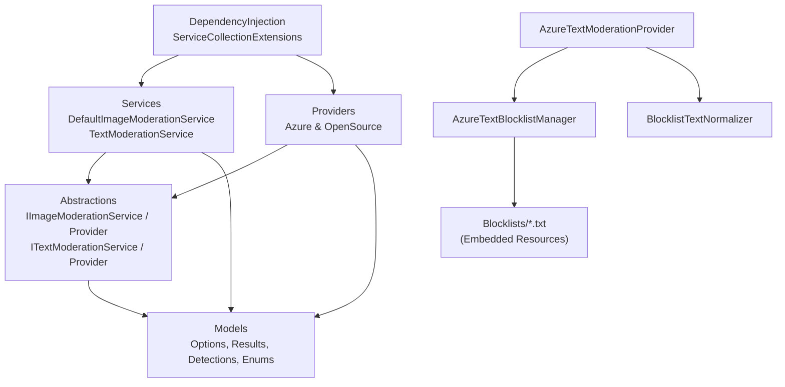

# Project Structure — `ContentModeration` (`ContentModerationWrapper`)

This document provides a complete structural reference for the `ContentModeration` .NET 8 class library, including directory layout, file responsibilities, public/internal types, embedded resources, and architectural dependency flows.

---

## 1. Directory Tree

```text
ContentModerationWrapper/
├── ContentModeration.csproj                         # Project definition (.NET 8), NuGet packages & embedded resources
├── README.md                                        # Overview, setup, configuration & usage guide
├── PROJECT_STRUCTURE.md                             # Detailed directory, file & symbol structure reference
│
├── Abstractions/                                    # Public service & provider interfaces
│   ├── IImageModerationProvider.cs                  # Contract for image moderation provider engines
│   ├── IImageModerationService.cs                   # Application-facing image moderation service contract
│   ├── ITextModerationProvider.cs                   # Contract for text moderation provider engines
│   └── ITextModerationService.cs                    # Application-facing text moderation service contract
│
├── Blocklists/                                      # Embedded UTF-8 blocklist files (LogicalName: ContentModeration.Blocklists.*)
│   ├── fil-ceb-hate.txt                             # Tagalog / Cebuano hate speech & slurs (Severity 4)
│   ├── fil-ceb-insults.txt                          # Tagalog / Cebuano mild insults (Severity 2)
│   ├── fil-ceb-profanity.txt                        # Tagalog / Cebuano / Taglish profanity & expletives (Severity 4)
│   ├── fil-ceb-selfharm.txt                         # Tagalog / Cebuano self-harm encouragement (Severity 6)
│   ├── fil-ceb-sexual.txt                           # Tagalog / Cebuano explicit sexual vulgarities (Severity 6)
│   └── fil-ceb-threats.txt                          # Tagalog / Cebuano violent threats (Severity 6)
│
├── Datasets/                                        # Reference moderation datasets
│   └── ph_moderation_batch1_cebuano.json            # Verified Cebuano/Bisaya moderation lexicon with regional & contextual metadata
│
├── DependencyInjection/                             # Microsoft.Extensions.DependencyInjection registrations
│   └── ServiceCollectionExtensions.cs               # AddImageModeration() and AddTextModeration() overloads
│
├── Models/                                          # Domain models, DTOs, enums & configuration options
│   ├── ImageDetection.cs                            # ImageDetection & ImageBoundingBox records
│   ├── ImageModerationOptions.cs                    # ImageModerationOptions, AzureModerationProviderOptions, OpenSourceModerationProviderOptions
│   ├── ImageModerationResult.cs                     # ImageModerationResult & ProviderAnalysisResult records
│   ├── ModerationCategory.cs                        # ModerationCategory, ImageModerationClassification, ModerationProvider enums
│   ├── TextBlocklistDefinition.cs                   # TextBlocklistDefinition class & ResolvedTextBlocklist record
│   ├── TextDetection.cs                             # TextDetection record
│   ├── TextModerationCategory.cs                    # TextModerationCategory & TextModerationClassification enums
│   ├── TextModerationOptions.cs                     # TextModerationOptions, AzureTextModerationOptions, OpenSourceTextModerationOptions
│   └── TextModerationResult.cs                      # TextModerationResult & TextProviderAnalysisResult records
│
├── Providers/                                       # Moderation engine implementations
│   ├── Azure/                                       # Azure AI Content Safety cloud implementations
│   │   ├── AzureContentSafetyProvider.cs            # Azure image moderation provider (auto-downscales >4MB or >2048px images)
│   │   ├── AzureTextBlocklistManager.cs             # Background Azure BlocklistClient provisioner & embedded resource loader
│   │   ├── AzureTextModerationProvider.cs           # Azure text moderation provider with blocklist & normalization integration
│   │   └── BlocklistTextNormalizer.cs               # Obfuscated text normalizer (leetspeak, diacritics, separators, elongations)
│   │
│   └── OpenSource/                                  # Local ONNX Runtime & heuristic implementations
│       ├── OpenSourceModerationProvider.cs          # Local ONNX image inference (NudeNet v3, SwiftFormer, ViT Violence)
│       └── OpenSourceTextModerationProvider.cs      # Local ONNX BERT (WordPiece) + contextual multi-category regex classifier
│
└── Services/                                        # High-level orchestration, fallback & threshold classification
    ├── DefaultImageModerationService.cs             # Image validation, provider routing, fallback & threshold classification
    └── TextModerationService.cs                     # Text validation, provider routing, fallback & threshold classification
```

---

## 2. Layer-by-Layer Breakdown

### 2.1 Root Project Configuration

| File | Description |
| :--- | :--- |
| `ContentModeration.csproj` | Targets `net8.0` with `<Nullable>enable</Nullable>` and `<GenerateDocumentationFile>true</GenerateDocumentationFile>`. Embeds `Blocklists\*.txt` as manifest resources (`ContentModeration.Blocklists.<filename>.txt`) and exposes internals to `ContentSafe.Tests` and `ServiceAppLibAPI.AdvancedUnit`. |

---

### 2.2 `Abstractions/` — Service & Provider Contracts

Namespace: `ContentModeration.Abstractions`

| File | Type | Responsibility |
| :--- | :--- | :--- |
| `IImageModerationService.cs` | `interface IImageModerationService` | Primary application entry point for analyzing image `Stream` or `byte[]` payloads and querying provider availability (`GetProviderAvailability()`). |
| `IImageModerationProvider.cs` | `interface IImageModerationProvider` | Contract implemented by each image moderation backend (`ProviderType`, `ProviderName`, `IsAvailable`, `AvailabilityError`, `AnalyzeAsync(byte[], CancellationToken)`). |
| `ITextModerationService.cs` | `interface ITextModerationService` | Primary application entry point for moderating text strings with optional per-call `ModerationProvider? providerOverride`. |
| `ITextModerationProvider.cs` | `interface ITextModerationProvider` | Contract implemented by each text moderation backend (`ProviderType`, `ProviderName`, `IsAvailable`, `AvailabilityError`, `AnalyzeTextAsync(string, CancellationToken)`). |

---

### 2.3 `Models/` — Options, Enums & Data Transfer Objects

Namespace: `ContentModeration.Models`

| File | Types Defined | Responsibility |
| :--- | :--- | :--- |
| `ModerationCategory.cs` | `enum ModerationCategory`<br>`enum ImageModerationClassification`<br>`enum ModerationProvider` | Defines normalized image categories (`Nudity`, `SexualContent`, `SuggestiveContent`, `Gore`, `Violence`, `MatureContent`, `SelfHarm`, `Hate`, `Anatomical`), overall image classifications (`Safe`, `PotentiallyMature`, `Explicit`, `ReviewRequired`), and provider modes (`OpenSource`, `Azure`, `Hybrid`). |
| `ImageDetection.cs` | `record ImageBoundingBox`<br>`record ImageDetection` | Represents a single image detection with `Category`, `RawCategory`, `ProviderName`, `Confidence` (`0.0–1.0`), `ConfidencePercent` (`0.0–100.0`), `Severity` (`0, 2, 4, 6` for Azure), and optional pixel `BoundingBox` (`X, Y, Width, Height`). |
| `ImageModerationResult.cs` | `record ProviderAnalysisResult`<br>`record ImageModerationResult` | Encapsulates individual provider outcomes and the final aggregated image moderation response (`IsFlagged`, `Classification`, `Detections`, `ProvidersUsed`, `ProcessingDuration`, `ProcessingTimeMs`, `FallbackUsed`, `Errors`, `ProviderAvailability`). |
| `ImageModerationOptions.cs` | `class ImageModerationOptions`<br>`class AzureModerationProviderOptions`<br>`class OpenSourceModerationProviderOptions` | Configuration options bound from `"ImageModeration"`, including file/pixel safety limits, fallback flags, Azure credentials/severity thresholds, and ONNX model paths/confidence thresholds. |
| `TextModerationCategory.cs` | `enum TextModerationCategory`<br>`enum TextModerationClassification` | Defines normalized text categories (`SexualAndExplicit`, `HateAndHarassment`, `ThreatsAndViolence`, `SelfHarm`, `ProfanityAndAbuse`, `OtherHarmful`) and text classifications (`Safe`, `PotentiallyHarmful`, `Violation`, `ReviewRequired`). |
| `TextDetection.cs` | `record TextDetection` | Represents a single harmful text detection with `Category`, `RawCategory`, `ProviderName`, `Confidence`, `ConfidencePercent`, `Severity`, and human-readable `Description`. |
| `TextModerationResult.cs` | `record TextProviderAnalysisResult`<br>`record TextModerationResult` | Encapsulates individual text provider results and the final aggregated text moderation response (`IsFlagged`, `IsViolation`, `Classification`, `Detections`, `ProviderName`, `ProvidersUsed`, `ProcessingDuration`, `ProcessingTimeMs`, `FallbackUsed`, `RequiresManualReview`, `Errors`). |
| `TextModerationOptions.cs` | `class TextModerationOptions`<br>`class AzureTextModerationOptions`<br>`class OpenSourceTextModerationOptions` | Configuration options bound from `"ContentModeration:Text"`, including max text length, timeouts, Azure credentials, blocklist auto-provisioning toggles, and open-source model/threshold settings. |
| `TextBlocklistDefinition.cs` | `class TextBlocklistDefinition`<br>`record ResolvedTextBlocklist` | Defines custom Azure text blocklist metadata (`Name`, `Description`, `Category`, `Severity`, `TermsFile`, `Terms`) and the de-duplicated resolved record used for provisioning. |

---

### 2.4 `Services/` — Orchestration & Classification Layer

Namespace: `ContentModeration.Services`

| File | Type | Key Responsibilities |
| :--- | :--- | :--- |
| `DefaultImageModerationService.cs` | `class DefaultImageModerationService : IImageModerationService` | • Validates image streams/bytes (size, magic header bytes for JPEG/PNG/WebP/GIF/BMP, max dimensions, max total pixels).<br>• Executes `Azure`, `OpenSource`, or `Hybrid` providers.<br>• In `Hybrid` mode with `SkipAzureWhenLocalBlocks = true`, runs `OpenSource` first and skips `Azure` if already classified as `Explicit`.<br>• Handles automatic fallback when the primary provider fails.<br>• Evaluates Azure severity and OpenSource confidence thresholds via `ClassifyDetections()`. |
| `TextModerationService.cs` | `class TextModerationService : ITextModerationService` | • Validates input text (non-empty, within `MaxTextLength`).<br>• Supports per-request `providerOverride` or configured `Provider` (`Azure`, `OpenSource`, `Hybrid`).<br>• Handles automatic fallback on primary failure.<br>• Evaluates per-category and global thresholds via `ClassifyDetections()` to determine `Safe`, `PotentiallyHarmful`, `Violation`, or `ReviewRequired`. |

---

### 2.5 `Providers/Azure/` — Cloud AI Content Safety Providers

Namespace: `ContentModeration.Providers.Azure`

| File | Type | Key Responsibilities |
| :--- | :--- | :--- |
| `AzureContentSafetyProvider.cs` | `class AzureContentSafetyProvider : IImageModerationProvider` | • Caches `ContentSafetyClient` instances keyed by endpoint URI and SHA-256 API key hash.<br>• Automatically downscales/re-encodes images >4 MB or >2048 px to JPEG (85% quality) via `SkiaSharp` before calling `AnalyzeImageAsync`.<br>• Maps Azure `ImageCategory` (`Sexual`, `Violence`, `SelfHarm`, `Hate`) to `ModerationCategory`. |
| `AzureTextModerationProvider.cs` | `class AzureTextModerationProvider : ITextModerationProvider` | • Normalizes obfuscated text via `BlocklistTextNormalizer.BuildAnalysisText()`.<br>• Queries ready blocklists from `AzureTextBlocklistManager` and calls `AnalyzeTextAsync` with `FourSeverityLevels`.<br>• Automatically retries without blocklists and invalidates cache if Azure returns HTTP 400/404 for a not-yet-provisioned blocklist.<br>• Exposes `WarmUpBlocklistsAsync()` for optional startup pre-provisioning. |
| `AzureTextBlocklistManager.cs` | `class AzureTextBlocklistManager` | • Loads embedded `ContentModeration.Blocklists.*.txt` resources and custom `TextBlocklistDefinition` items/files.<br>• Computes a SHA-256 fingerprint of credentials + blocklist definitions and provisions missing items in 100-item batches via `BlocklistClient` on a background task. |
| `BlocklistTextNormalizer.cs` | `static class BlocklistTextNormalizer` | • Strips Unicode non-spacing marks (`putañgina` → `putangina`).<br>• Decodes in-word leetspeak (`4/@`→`a`, `1/!`→`i`, `3`→`e`, `0`→`o`, `5/$`→`s`, `7`→`t`).<br>• Removes in-word separators (`g.a.g.o` → `gago`) and collapses 3+ elongated letters (`gagoooo` → `gago`). |

---

### 2.6 `Providers/OpenSource/` — Local ONNX & Heuristic Providers

Namespace: `ContentModeration.Providers.OpenSource`

| File | Type | Key Responsibilities |
| :--- | :--- | :--- |
| `OpenSourceModerationProvider.cs` | `class OpenSourceModerationProvider : IImageModerationProvider, IDisposable` | • Manages three `Microsoft.ML.OnnxRuntime.InferenceSession` instances behind a `SemaphoreSlim` concurrency gate:<br>  1. **NudeNet v3 (`320n.onnx`)**: `320×320` tensor preprocessing, anchor decoding, IoU Non-Maximum Suppression (NMS), and bounding box rescaling.<br>  2. **SwiftFormer (`image-safety-classifier-xs.onnx`)**: `224×224` RGB `[0, 255]` inference for `GORE` (NSFL), `MATURE_CONTENT`, and `SUGGESTIVE_CONTENT`.<br>  3. **ViT Violence (`vit-violence-detection.onnx`)**: `224×224` RGB `[-1, 1]` inference for `VIOLENCE`. |
| `OpenSourceTextModerationProvider.cs` | `class OpenSourceTextModerationProvider : ITextModerationProvider, IDisposable` | • Runs an optional local WordPiece BERT ONNX model (`toxic-bert` 6-label sigmoid classification) when `ModelPath` and `VocabPath` are present.<br>• Runs compiled multi-category regex heuristics (`SELF_HARM_ENCOURAGEMENT`, `THREAT_AND_VIOLENCE`, `SEXUAL_EXPLICIT`, `HATE_AND_HARASSMENT`, `PROFANITY_AND_ABUSE`) with contextual false-positive dampening for educational/clinical/historical text. |

---

### 2.7 `DependencyInjection/` — Service Registration

Namespace: `ContentModeration.DependencyInjection`

| File | Type | Methods |
| :--- | :--- | :--- |
| `ServiceCollectionExtensions.cs` | `static class ServiceCollectionExtensions` | • `AddImageModeration(IServiceCollection, Action<ImageModerationOptions>?)`<br>• `AddImageModeration(IServiceCollection, IConfiguration, Action<ImageModerationOptions>?, string)`<br>• `AddTextModeration(IServiceCollection, Action<TextModerationOptions>?)`<br>• `AddTextModeration(IServiceCollection, IConfigurationSection, Action<TextModerationOptions>?)`<br>• `AddTextModeration(IServiceCollection, IConfiguration, Action<TextModerationOptions>?, string)` |

---

### 2.8 `Blocklists/` & `Datasets/` — Linguistic Resources

| Path | Format | Purpose |
| :--- | :--- | :--- |
| `Blocklists/fil-ceb-profanity.txt` | UTF-8 text (Embedded) | Tagalog, Cebuano, and Taglish profanity/expletives (`ProfanityAndAbuse`, Severity `4`). |
| `Blocklists/fil-ceb-insults.txt` | UTF-8 text (Embedded) | Tagalog and Cebuano mild insults (`ProfanityAndAbuse`, Severity `2`). |
| `Blocklists/fil-ceb-sexual.txt` | UTF-8 text (Embedded) | Tagalog and Cebuano explicit sexual vulgarities (`SexualAndExplicit`, Severity `6`). |
| `Blocklists/fil-ceb-hate.txt` | UTF-8 text (Embedded) | Tagalog and Cebuano hate speech and slurs (`HateAndHarassment`, Severity `4`). |
| `Blocklists/fil-ceb-threats.txt` | UTF-8 text (Embedded) | Tagalog and Cebuano violent threats (`ThreatsAndViolence`, Severity `6`). |
| `Blocklists/fil-ceb-selfharm.txt` | UTF-8 text (Embedded) | Tagalog and Cebuano self-harm encouragement (`SelfHarm`, Severity `6`). |
| `Datasets/ph_moderation_batch1_cebuano.json` | JSON array | Structured Cebuano/Bisaya moderation dataset with `term`, `normalized_term`, `regional_variants`, `category`, `severity`, `meaning_en`, `variants`, `offensive_usage_example`, and `benign_usage_note`. |

---

## 3. Component Dependency Graph


