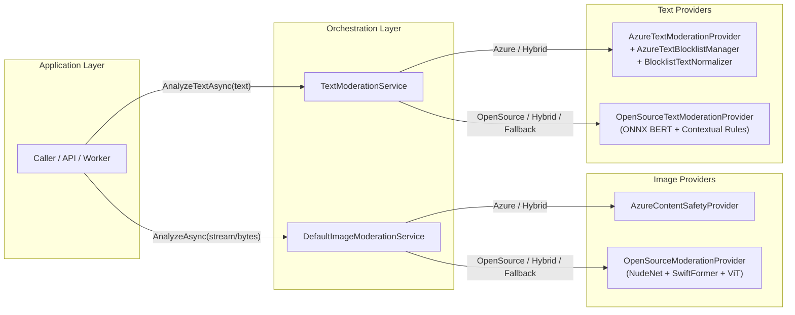

# ContentModeration (`ContentModerationWrapper`)

A reusable **.NET 8** content moderation class library providing unified **Image Moderation** and **Text Moderation** across **Azure AI Content Safety** and **Local Open-Source ONNX Models**, with built-in **Hybrid** execution, automatic provider fallback, fail-safe error handling, and **Tagalog / Cebuano / Taglish** custom blocklist auto-provisioning.

---

## Table of Contents

1. [Project Analysis & Key Capabilities](#1-project-analysis--key-capabilities)
2. [Project Structure](#2-project-structure)
3. [Architecture & Moderation Workflow](#3-architecture--moderation-workflow)
4. [Prerequisites & Model Setup](#4-prerequisites--model-setup)
5. [Installation & Dependency Injection](#5-installation--dependency-injection)
6. [Configuration Reference](#6-configuration-reference)
7. [Usage Instructions & Examples](#7-usage-instructions--examples)
8. [Categories, Classifications & Thresholds](#8-categories-classifications--thresholds)
9. [Filipino / Cebuano Blocklists & Obfuscation Normalizer](#9-filipino--cebuano-blocklists--obfuscation-normalizer)

---

## 1. Project Analysis & Key Capabilities

`ContentModeration` is designed as a framework-agnostic .NET 8 library (independent of ASP.NET Core controller/HTTP primitives) that can be registered into any `IServiceCollection` host (Web APIs, background workers, desktop or console services).

### Core Highlights

- **Dual Modality (Image & Text)**
  - **Image Moderation (`IImageModerationService`)**: Detects explicit nudity, sexual content, suggestive content, gore (NSFL), graphic violence, self-harm, and hate symbols. Validates magic bytes (JPEG, PNG, WebP, GIF, BMP), file size limits, image dimensions, and pixel counts to prevent decompression bombs.
  - **Text Moderation (`ITextModerationService`)**: Detects sexual/explicit language, hate speech & harassment, threats & violence, self-harm encouragement, and profanity/abuse.
- **Three Execution Modes (`ModerationProvider`)**
  - `Azure`: Cloud-based moderation via the official `Azure.AI.ContentSafety` SDK (returns integer severities `0, 2, 4, 6`).
  - `OpenSource`: Local offline inference via `Microsoft.ML.OnnxRuntime` and `SkiaSharp` (returns probability confidences `0.0–1.0` and pixel bounding boxes for anatomical detections).
  - `Hybrid`: Combines both engines. For images, supports short-circuiting Azure API calls (`SkipAzureWhenLocalBlocks = true`) when local ONNX models already classify an image as `Explicit`, saving cloud cost and latency.
- **Resilient Fallback & Fail-Safe Guarantees**
  - Automatic fallback to a secondary provider (`FallbackProvider`) when the primary provider times out, hits rate limits (HTTP 429), or is unconfigured.
  - **Never silently marks content as `Safe` when all providers fail**: either throws `InvalidOperationException` or returns `ReviewRequired` (`IsFlagged = true`) when `ReturnReviewRequiredOnFailure` is enabled.
- **Built-in Philippine Language Support (Tagalog, Cebuano, Taglish)**
  - Includes embedded resource blocklists (`Blocklists/fil-ceb-*.txt`) and a curated Cebuano moderation dataset (`Datasets/ph_moderation_batch1_cebuano.json`).
  - Background blocklist provisioning via `AzureTextBlocklistManager` and leetspeak/separator/elongation de-obfuscation via `BlocklistTextNormalizer`.

---

## 2. Project Structure

```text
ContentModerationWrapper/
├── ContentModeration.csproj                         # .NET 8 SDK project, NuGet dependencies & embedded blocklists
├── README.md                                        # Project documentation, structure & usage instructions
├── Abstractions/                                    # Public service & provider contracts
│   ├── IImageModerationProvider.cs                  # Contract for individual image moderation engines
│   ├── IImageModerationService.cs                   # Application-facing image moderation service interface
│   ├── ITextModerationProvider.cs                   # Contract for individual text moderation engines
│   └── ITextModerationService.cs                    # Application-facing text moderation service interface
├── Blocklists/                                      # Embedded Tagalog/Cebuano/Taglish blocklist resources
│   ├── fil-ceb-hate.txt                             # Hate speech and discriminatory slurs (Severity 4)
│   ├── fil-ceb-insults.txt                          # Mild insults and derogatory terms (Severity 2)
│   ├── fil-ceb-profanity.txt                        # Expletives and profanity (Severity 4)
│   ├── fil-ceb-selfharm.txt                         # Self-harm encouragement and ideation (Severity 6)
│   ├── fil-ceb-sexual.txt                           # Explicit sexual vulgarities (Severity 6)
│   └── fil-ceb-threats.txt                          # Direct threats of physical violence (Severity 6)
├── Datasets/                                        # Reference lexical datasets
│   └── ph_moderation_batch1_cebuano.json            # Verified Cebuano/Bisaya moderation lexicon with metadata
├── DependencyInjection/                             # IServiceCollection extensions
│   └── ServiceCollectionExtensions.cs               # AddImageModeration() and AddTextModeration() registrations
├── Models/                                          # Options, detection DTOs, enums & results
│   ├── ImageDetection.cs                            # Image detection record + ImageBoundingBox
│   ├── ImageModerationOptions.cs                    # Options for image moderation, Azure & OpenSource ONNX paths
│   ├── ImageModerationResult.cs                     # ImageModerationResult & ProviderAnalysisResult records
│   ├── ModerationCategory.cs                        # ModerationCategory, ImageModerationClassification, ModerationProvider
│   ├── TextBlocklistDefinition.cs                   # Custom blocklist configuration & ResolvedTextBlocklist
│   ├── TextDetection.cs                             # Text detection record with severity/confidence normalization
│   ├── TextModerationCategory.cs                    # TextModerationCategory & TextModerationClassification enums
│   ├── TextModerationOptions.cs                     # Options for text moderation, blocklists & thresholds
│   └── TextModerationResult.cs                      # TextModerationResult & TextProviderAnalysisResult records
├── Providers/                                       # Concrete provider implementations
│   ├── Azure/
│   │   ├── AzureContentSafetyProvider.cs            # Azure AI Content Safety image analysis (auto-resizes >4MB/>2048px)
│   │   ├── AzureTextBlocklistManager.cs             # Background provisioning of custom & built-in blocklists
│   │   ├── AzureTextModerationProvider.cs           # Azure AI Content Safety text & blocklist analysis
│   │   └── BlocklistTextNormalizer.cs               # De-obfuscates leetspeak, separators & elongated letters
│   └── OpenSource/
│       ├── OpenSourceModerationProvider.cs          # Local ONNX inference: NudeNet v3, SwiftFormer, ViT Violence
│       └── OpenSourceTextModerationProvider.cs      # Local ONNX BERT (toxic-bert) + contextual regex heuristics
└── Services/                                        # Orchestration, fallback & threshold classification
    ├── DefaultImageModerationService.cs             # Orchestrates image providers, validation & classification
    └── TextModerationService.cs                     # Orchestrates text providers, fallback & classification
```

---

## 3. Architecture & Moderation Workflow



### Key Architectural Behaviors

1. **Image Validation & Pre-Processing**
   - `DefaultImageModerationService` verifies magic bytes (`JPEG`, `PNG`, `WEBP`, `GIF`, `BMP`), enforces `MaxFileSizeBytes` (default 10 MB), `MaxImageDimension` (default 8192 px), and `MaxTotalPixels` (default ~33.5 MP).
   - `AzureContentSafetyProvider` automatically downscales/re-encodes images exceeding Azure's 4 MB or 2048×2048 synchronous API limit using `SkiaSharp`.
2. **Local ONNX Image Pipeline (`OpenSourceModerationProvider`)**
   - **NudeNet v3 (`320n.onnx`)**: Detects 18 anatomical classes with Non-Maximum Suppression (NMS) and returns pixel-level `ImageBoundingBox` coordinates. Benign classes (`FACE_FEMALE`, `FACE_MALE`, `FEET_*`, `ARMPITS_*`, `BELLY_COVERED`) are mapped to `ModerationCategory.Anatomical` so they do not false-flag safe portraits.
   - **SwiftFormer (`image-safety-classifier-xs.onnx`)**: Classifies `GORE` (NSFL), `MATURE_CONTENT`, and `SUGGESTIVE_CONTENT`.
   - **ViT Violence (`vit-violence-detection.onnx`)**: Classifies graphic `VIOLENCE`.
   - Protected by a configurable `SemaphoreSlim` concurrency gate (`MaxConcurrentInferences`, default `4`).
3. **Text Moderation & Contextual False-Positive Reduction**
   - `AzureTextModerationProvider` runs Azure's 4-severity classifier alongside auto-provisioned custom blocklists, appending normalized text from `BlocklistTextNormalizer` so obfuscated profanity (e.g., `t4ngina`, `g.a.g.o`, `gagoooo`) still triggers blocklist hits.
   - `OpenSourceTextModerationProvider` runs an optional local WordPiece BERT ONNX model (such as `toxic-bert`) plus compiled multi-category regex rules with educational/clinical/prevention context dampening (`EnableContextualFalsePositiveReduction`).

---

## 4. Prerequisites & Model Setup

### Runtime & SDK
- **.NET 8.0 SDK** (`net8.0`)

### NuGet Dependencies (Included in `ContentModeration.csproj`)
- `Azure.AI.ContentSafety` (`1.0.0`)
- `Microsoft.ML.OnnxRuntime` (`1.19.2`)
- `SkiaSharp` (`2.88.8`) & `SkiaSharp.NativeAssets.Linux.NoDependencies` (`2.88.8`)
- `Microsoft.Extensions.Options`, `Configuration`, `DependencyInjection`, `Logging` (`8.0.x`)

### Local ONNX Models (For `OpenSource` or `Hybrid` Image/Text Modes)
By default, `OpenSourceModerationProvider` looks for ONNX models relative to the application working/base directory (configurable via `OpenSource.BaseDirectory`):

| Model Purpose | Default Relative Path | Input Resolution / Format |
| :--- | :--- | :--- |
| **NudeNet v3 (Nudity)** | `models/320n.onnx` | `320x320` RGB `[0, 1]` |
| **SwiftFormer (Gore / Mature)** | `models/image-safety-classifier-xs.onnx` | `224x224` RGB `[0, 255]` |
| **ViT (Violence Detection)** | `models/vit-violence-detection.onnx` | `224x224` RGB `[-1, 1]` |
| **Toxic-BERT (Optional Text ONNX)** | Configured via `OpenSource.ModelPath` & `VocabPath` | WordPiece `128` tokens |

> **Note:** `OpenSourceTextModerationProvider` works out-of-the-box without an ONNX file by using its built-in contextual heuristic classifier.

---

## 5. Installation & Dependency Injection

Add a project reference to `ContentModeration.csproj`:

```bash
dotnet add reference path/to/ContentModeration.csproj
```

Register the services in `Program.cs` using `ContentModeration.DependencyInjection`:

```csharp
using ContentModeration.DependencyInjection;
using ContentModeration.Models;

var builder = WebApplication.CreateBuilder(args);

// 1. Register Image Moderation (binds from "ImageModeration" config section + env vars)
builder.Services.AddImageModeration(builder.Configuration, options =>
{
    options.Provider = ModerationProvider.Hybrid;
    options.EnableFallback = true;
    options.FallbackProvider = ModerationProvider.OpenSource;
});

// 2. Register Text Moderation (binds from "ContentModeration:Text" config section + env vars)
builder.Services.AddTextModeration(builder.Configuration, options =>
{
    options.Provider = ModerationProvider.Azure;
    options.EnableFallback = true;
    options.FallbackProvider = ModerationProvider.OpenSource;
});
```

You can also register either service purely in code without `IConfiguration`:

```csharp
services.AddImageModeration(options =>
{
    options.Provider = ModerationProvider.OpenSource;
    options.OpenSource.BaseDirectory = @"C:\Models";
});

services.AddTextModeration(options =>
{
    options.Provider = ModerationProvider.OpenSource;
});
```

---

## 6. Configuration Reference

### `appsettings.json` Example

```json
{
  "ImageModeration": {
    "Provider": "Hybrid",
    "FallbackProvider": "OpenSource",
    "EnableFallback": true,
    "SkipAzureWhenLocalBlocks": true,
    "ReturnReviewRequiredOnFailure": false,
    "FlagPotentiallyMature": true,
    "TimeoutSeconds": 15,
    "MaxFileSizeBytes": 10485760,
    "MaxImageDimension": 8192,
    "MaxTotalPixels": 33554432,
    "Azure": {
      "Endpoint": "https://<your-resource>.cognitiveservices.azure.com/",
      "ApiKey": "",
      "TimeoutSeconds": 8,
      "MinimumReportedSeverity": 2,
      "PotentiallyMatureSeverityThreshold": 2,
      "ExplicitSeverityThreshold": 4,
      "CategoryExplicitSeverityThresholds": {
        "VIOLENCE": 4
      }
    },
    "OpenSource": {
      "BaseDirectory": null,
      "NudityModelPath": "models/320n.onnx",
      "InputResolution": 320,
      "EnableGoreAndMatureDetection": true,
      "GoreAndMatureModelPath": "models/image-safety-classifier-xs.onnx",
      "GoreMinimumConfidence": 0.50,
      "MatureContentMinimumConfidence": 0.75,
      "SuggestiveContentMinimumConfidence": 0.60,
      "EnableViolenceDetection": true,
      "ViolenceModelPath": "models/vit-violence-detection.onnx",
      "ViolenceMinimumConfidence": 0.70,
      "MinimumDetectionConfidence": 0.25,
      "NmsIouThreshold": 0.45,
      "MaxConcurrentInferences": 4,
      "ExplicitThreshold": 0.60,
      "PotentiallyMatureThreshold": 0.40
    }
  },
  "ContentModeration": {
    "Text": {
      "Provider": "Azure",
      "FallbackProvider": "OpenSource",
      "EnableFallback": true,
      "ReturnReviewRequiredOnFailure": true,
      "FlagPotentiallyHarmful": true,
      "MaxTextLength": 10000,
      "TimeoutSeconds": 10,
      "Azure": {
        "Endpoint": "https://<your-resource>.cognitiveservices.azure.com/",
        "ApiKey": "",
        "TimeoutSeconds": 8,
        "MinimumReportedSeverity": 2,
        "PotentiallyHarmfulSeverityThreshold": 2,
        "ViolationSeverityThreshold": 4,
        "AutoProvisionBlocklists": true,
        "UseBuiltInFilipinoBlocklists": true,
        "AppendNormalizedTextForBlocklistMatching": true,
        "HaltOnBlocklistHit": false,
        "BlocklistNames": [],
        "Blocklists": []
      },
      "OpenSource": {
        "ModelPath": null,
        "VocabPath": null,
        "MinimumConfidence": 0.40,
        "PotentiallyHarmfulThreshold": 0.45,
        "ViolationThreshold": 0.75,
        "EnableContextualFalsePositiveReduction": true
      }
    }
  }
}
```

### Supported Environment Variable Overrides

| Environment Variable | Description |
| :--- | :--- |
| `AZURE_CONTENT_SAFETY_ENDPOINT` | Fallback endpoint URL for both image and text Azure providers |
| `AZURE_CONTENT_SAFETY_API_KEY` | Fallback API key for both image and text Azure providers |
| `IMAGE_MODERATION_PROVIDER` | Overrides `ImageModeration:Provider` (`Azure`, `OpenSource`, `Hybrid`) |
| `IMAGE_MODERATION_FALLBACK_PROVIDER` | Overrides `ImageModeration:FallbackProvider` |
| `TEXT_MODERATION_PROVIDER` | Overrides `ContentModeration:Text:Provider` (`Azure`, `OpenSource`, `Hybrid`) |

---

## 7. Usage Instructions & Examples

### Moderating an Image (`IImageModerationService`)

```csharp
using ContentModeration.Abstractions;
using ContentModeration.Models;

public class UploadHandler(IImageModerationService imageModeration)
{
    public async Task<IResult> ValidateUploadAsync(Stream imageStream, CancellationToken ct)
    {
        ImageModerationResult result = await imageModeration.AnalyzeAsync(imageStream, ct);

        if (result.Classification == ImageModerationClassification.Explicit)
        {
            return Results.BadRequest(new
            {
                message = "Image contains explicit content and cannot be uploaded.",
                classification = result.Classification,
                detections = result.Detections
            });
        }

        if (result.IsFlagged) // PotentiallyMature or ReviewRequired
        {
            // Queue for manual moderator review or apply a content warning blur
        }

        return Results.Ok(result);
    }
}
```

### Moderating Text (`ITextModerationService`)

```csharp
using ContentModeration.Abstractions;
using ContentModeration.Models;

public class CommentService(ITextModerationService textModeration)
{
    public async Task<TextModerationResult> ModerateCommentAsync(string comment, CancellationToken ct)
    {
        // Optionally pass a per-call providerOverride (Azure, OpenSource, or Hybrid)
        TextModerationResult result = await textModeration.AnalyzeTextAsync(
            comment,
            cancellationToken: ct,
            providerOverride: null);

        if (result.IsViolation)
        {
            // Block immediately (Classification == TextModerationClassification.Violation)
        }
        else if (result.IsFlagged)
        {
            // PotentiallyHarmful or ReviewRequired -> hold for review or warn user
        }

        return result;
    }
}
```

### Warming Up Azure Blocklists at Startup (Optional)

Blocklist provisioning runs asynchronously in the background by default so analysis calls never block on network I/O. If you want blocklists guaranteed provisioned before serving traffic, call `WarmUpBlocklistsAsync()` at startup:

```csharp
var azureTextProvider = app.Services.GetRequiredService<AzureTextModerationProvider>();
await azureTextProvider.WarmUpBlocklistsAsync();
```

---

## 8. Categories, Classifications & Thresholds

### Image Classifications (`ImageModerationClassification`)
- `Safe`: No detections exceeded configured thresholds.
- `PotentiallyMature`: Suggestive, covered anatomical, or moderate severity detections (sets `IsFlagged = FlagPotentiallyMature`).
- `Explicit`: Explicit nudity, high-confidence/high-severity sexual content, violence, gore, or self-harm (`IsFlagged = true`).
- `ReviewRequired`: Returned when all providers fail and `ReturnReviewRequiredOnFailure = true` (`IsFlagged = true`).

### Text Classifications (`TextModerationClassification`)
- `Safe`: No detections exceeded configured thresholds (`IsFlagged = false`, `IsViolation = false`).
- `PotentiallyHarmful`: Moderate severity/confidence detections (`IsFlagged = FlagPotentiallyHarmful`, `IsViolation = false`).
- `Violation`: Severe policy violation (`IsFlagged = true`, `IsViolation = true`).
- `ReviewRequired`: Returned when all providers fail and `ReturnReviewRequiredOnFailure = true` (`IsFlagged = true`, `RequiresManualReview = true`).

### Score Normalization
- **Azure AI Content Safety** returns integer severities (`0`, `2`, `4`, `6`). Both `ImageDetection` and `TextDetection` preserve `Severity` and compute a normalized `Confidence = round(severity / 6.0, 4)` (`ConfidencePercent` in `0.0–100.0`).
- **Open-Source Models** return floating-point probabilities in `[0.0, 1.0]` (`Severity = null`).

---

## 9. Filipino / Cebuano Blocklists & Obfuscation Normalizer

Azure AI Content Safety's built-in neural classifiers are trained on a limited set of languages. To provide comprehensive coverage for Philippine languages (**Tagalog**, **Cebuano/Bisaya**, and **Taglish**):

1. **Built-in Embedded Blocklists (`UseBuiltInFilipinoBlocklists = true`)**
   - `fil-ceb-profanity` → `ProfanityAndAbuse` (Severity `4`)
   - `fil-ceb-insults` → `ProfanityAndAbuse` (Severity `2`)
   - `fil-ceb-sexual` → `SexualAndExplicit` (Severity `6`)
   - `fil-ceb-hate` → `HateAndHarassment` (Severity `4`)
   - `fil-ceb-threats` → `ThreatsAndViolence` (Severity `6`)
   - `fil-ceb-selfharm` → `SelfHarm` (Severity `6`)
2. **Obfuscation Normalizer (`BlocklistTextNormalizer`)**
   - When `AppendNormalizedTextForBlocklistMatching = true`, the normalizer strips diacritics (`putañgina` → `putangina`), decodes in-word leetspeak (`t4ng1na` → `tangina`, `g@go` → `gago`, `p0ta` → `pota`), removes in-word separators (`g.a.g.o` → `gago`), and collapses elongated letters (`gagoooo` → `gago`).
3. **Extending or Adding Custom Blocklists**
   - Add entries to `ContentModeration:Text:Azure:Blocklists` in `appsettings.json` (via inline `Terms` or a `TermsFile` path). Using the same `Name` as a built-in list merges your custom terms with the built-in terms.

---

## Building the Project

```bash
dotnet build ContentModeration.csproj -c Release
```
